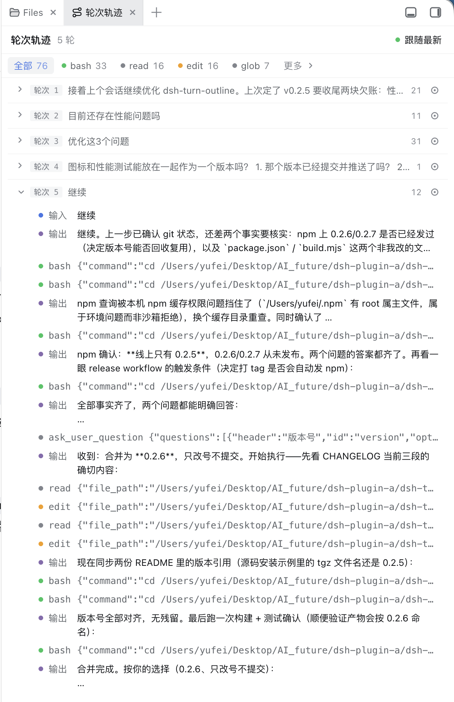
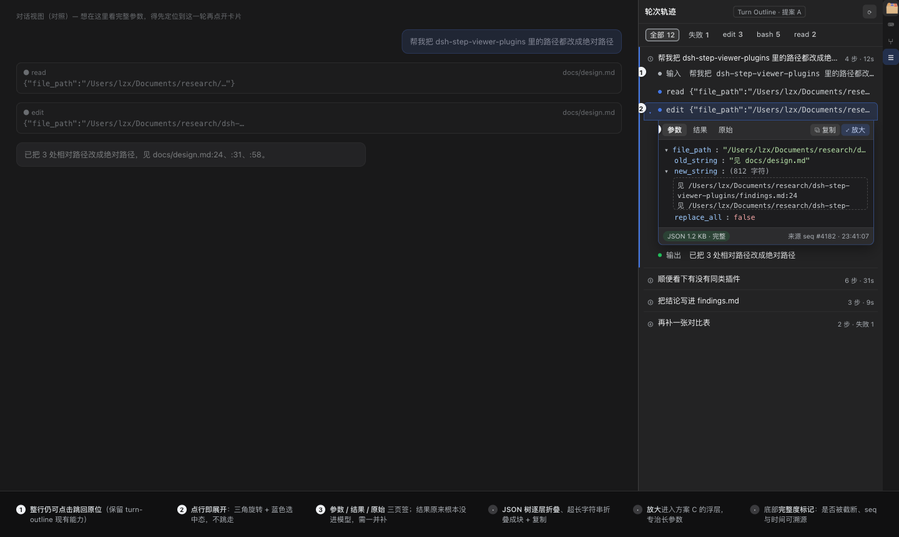
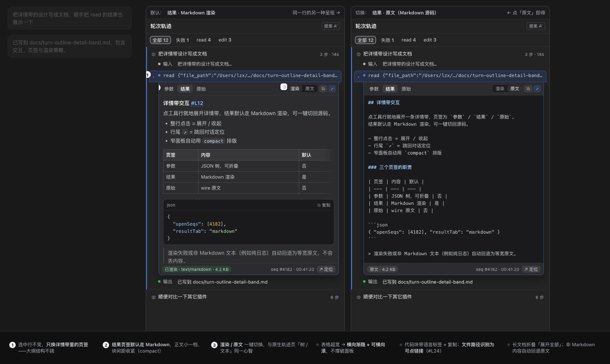

# dsh-trace-inspect

> A DSH plugin: registers a **Turn Outline** tab in the [dsh-better-sidebar](https://github.com/omdsh-dev/DSH-better-sidebar) sidebar — folds a session into user turns (input + tool steps + output), **expands any tool step in place to inspect its full arguments (JSON tree), its result (Markdown rendered, with a raw fallback), images and errors**, and keeps structured jump-back into the conversation.
>
> This repository is a detail-inspection fork of [Andor-Z/dsh-turn-outline](https://github.com/Andor-Z/dsh-turn-outline) (MIT): since v0.4.0 it ships under its own package name `dsh-trace-inspect`, keeping the upstream folding and jump-back logic.

[](LICENSE)
[](https://github.com/xx529/dsh-trace-inspect/releases)
[](https://github.com/topics/dsh-plugin)
[](https://github.com/omdsh-dev/DSH-better-sidebar)
[](https://github.com/omdsh-dev/DSH-better-sidebar)

[中文](README.md)

## Preview

<p align="center">
  
</p>

> Real-session screenshot (collapsed state — the visual baseline since v0.3.1): the whole session folds into turns 1-5, each = user input + tool steps + final output; the tool filter chips at the top (All / bash / read / edit / More) aggregate by semantic dot. Since v0.4.0, clicking a tool row expands its detail band in place and the trailing `↗` jumps back to its place in the conversation.

## Detail inspection (v0.4.0)

<p align="center">
  
  
</p>

> Design mockups (left `A-inline-expand`, right `A2-result-markdown`): clicking a tool row expands an **inline detail band** — `Params` as a collapsible JSON tree (long strings folded into blocks with per-field copy), `Result` rendered as Markdown by default with a one-click switch to the raw source, and `Raw` keeping the wire text; the footer marks `full`/`truncated` plus the seq.
>
> Since v0.5.0 the band also offers: **session-authorized image thumbnails** (the real image, not a placeholder), **on-demand full content** (auto-fetches the untruncated payload when the 32 KiB cap clipped it), and a **zoomed reading view** (`⤢` / `⌘⇧O`: Esc closes, `↑↓` steps, `⌘F` searches, `⌘C` copies, JSON export).
>
> ⚠️ These are **design mockups, not device screenshots**; real screenshots and the pixel-level comparison are still pending (the collapsed-state visual baseline is the real screenshot above).

## Overview

**Who it is for**: users of DeepSeek Harness (Web / Desktop profile) with long sessions who want to quickly revisit "what happened at step N" — at zero cost, without adding an LLM or touching the DSH core.

**What it solves**:

- **Fold the session into user turns** — the conversation is collapsed into a structured "input → tool steps → output" trail, so long sessions become scannable at a glance; multi-level folding inside a turn plus tool-type filter chips let you focus on what matters.
- **Expand details in place (new in v0.4.0)** — click a tool row to open an inline detail band with three tabs:
  - `Params`: the full tool arguments (the host cap is now 32 KiB instead of 512 chars) as a collapsible JSON tree, with long strings folded into blocks and per-field copy;
  - `Result`: the tool result text rendered as **Markdown** (GFM + TeX; raw HTML and unsafe protocols disabled), with a one-click switch to the raw source; `read`/`web_fetch` default to rendered, `bash`/`pwsh` to raw; the `read` `<path>/<type>/<content>` envelope is unwrapped first (line numbers and the tool footer stripped); image blocks render as **session-authorized thumbnails** (`GET /trace-inspect/api/attachment`, readable only when that session actually referenced the attachment), falling back to a placeholder chip on load failure; failed results show the error name/code plus the raw text;
  - `Raw`: the raw projected argument text (whitespace preserved).
  The footer marks `full`/`truncated` with the seq; results rewritten by a compaction plugin show the **replacement summary** and a `Replaced by compaction (seq #N)` note; when the 32 KiB cap clipped content, the band auto-fetches the **full payload** (`POST /trace-inspect/api/tool-detail`) and `⤢` opens the zoomed reading view.
- **Structured jump-back** — click a turn row or the trailing `↗` button on a tool row (the row itself now expands) to auto-load history and scroll to the matching row in the chat view / trajectory view. On 0.2.0 navigation goes through the client `uiConversation` conversation view registry (`anchorSeq` node matching + `loadOlder` paging); on 0.1.x it falls back to the legacy session snapshot — no dependence on DOM text or hashed class names.
- **Zero AI dependency** — pure event folding, no LLM calls: zero tokens, instant open, no failure states.
- **Read-only & non-invasive** — never touches the DSH core: one read-only host route + one client tab; registers cleanly and unloads without residue.
- **Incremental performance** — refreshes are driven by session subscriptions (no polling); `TrailFolder` only re-folds open turns (O(delta)); seq-keyed rows reconcile in place instead of remounting.

> 💡 Complements [dsh-conversation-outline](https://github.com/YesSanSan/dsh-conversation-outline): that plugin generates a one-line LLM title per turn ("conversation outline"); this one is LLM-free and folds the raw "turn trail". Both register distinct tabs and can be used side by side from better-sidebar's **+ menu**.

## Install

**Prerequisite**: a DSH plugin host + [dsh-better-sidebar](https://github.com/omdsh-dev/DSH-better-sidebar). This plugin declares better-sidebar as an **optional peer** — without it the plugin still loads, it just does not register the tab (inert, no side effects).

### Option 1: install from GitHub (recommended)

Install better-sidebar first, then this plugin:

```sh
npx @deepseek-ai/dsh plugin --profile desktop add dsh-better-sidebar
npx @deepseek-ai/dsh plugin --profile desktop add github:xx529/dsh-trace-inspect
```

> Using the Web profile? Swap `--profile desktop` for `--profile web`.
>
> ℹ️ **This repository is not published to npm**: `dsh-turn-outline` is the upstream Andor-Z package name (a different build without this repository's detail inspection). Use the GitHub install above, or build and install from source.
>
> ℹ️ **Version-line note**: **since 0.3.0 the primary line is DSH 0.2.0-rc.x** (tested against the DSH Desktop 2.0.17 bundled runtime + better-sidebar 0.24.1; jump-back rides the `uiConversation` conversation view registry and the host live path uses `snapshotEvents()`). The 0.1.x lines stay fallback-compatible — **better-sidebar 0.18.0 + DSH 0.1.2-rc.1** and **better-sidebar 0.17.1 + DSH 0.1.1-rc.x (stable)**: on older hosts the plugin automatically uses the legacy snapshot jump and the `.events` live path, with no configuration. Note that better-sidebar 0.18.0 supports only DSH 0.1.2-rc.1+: on an older stable host (0.1.0-rc.8 ~ 0.1.1-rc.2), pin `dsh-better-sidebar@0.17.1`.

### Option 2: install from source (development / offline)

```sh
git clone https://github.com/xx529/dsh-trace-inspect
cd dsh-trace-inspect
pnpm install && pnpm build && pnpm pack     # produces dsh-trace-inspect-0.4.0.tgz
npx @deepseek-ai/dsh plugin --profile desktop add "file:$(pwd)/dsh-trace-inspect-0.4.0.tgz"
```

### Restart & enable

Restart DSH (host-side changes need a full restart; client-side changes only need a hard refresh Cmd/Ctrl+Shift+R). Open better-sidebar's **+ menu** and pick **Turn Outline**.

### Uninstall

```sh
npx @deepseek-ai/dsh plugin --profile desktop remove dsh-trace-inspect
```

## Quick start

1. Install as above and restart DSH.
2. Open any session and add **Turn Outline** from better-sidebar's **+ menu**.
3. The trail is folded by user turn; click a tool row to expand its details in the sidebar (`Params` / `Result` / `Raw`), and use the trailing `↗` to jump back to its exact position in the conversation (chat view and trajectory view both supported).
4. Use the turn / tool filter chips to collapse what you do not need.

## Architecture

```
host (Node)      inject: ['webServer','sessionQuery','sessions']
  POST /trace-inspect/api/events { sessionId, afterSeq }
  → live sessions: borrow the frozen snapshot of the live store (snapshotEvents() on DSH
    0.2.0, the .events property on 0.1.x; O(1) probe + O(delta) projection, zero deep clones)
  → cold sessions: sessionQuery persisted log + lastSeq cache (LRU + byte cap)
  → paged responses (≤ PAGE_SIZE events and ≤ 2 MiB per page, hasMore semantics)
    + field trimming (tool/call arguments ≤ ARGS_CAP = 32 KiB, tool/result content ≤ 32 KiB)
  → 200 { events, hasMore } / 400 / 403 / 404 / 405 / 413

client (browser) inject: ['sessions','uiConversation','betterSidebar'] (the latter two are optional peers)
  → registerTab({ id:'trace-inspect', single:true, description })
  → jump-back: on 0.2.0 the ctx.uiConversation conversation view registry (chat/trajectory
    targets); on 0.1.x the legacy session snapshot's chat.nodes / views fields
  → subscription-driven refresh (session.subscribe + the 0.2.0 eventSource; no polling)
    + incremental folding (TrailFolder: only re-folds open turns)
    + seq-keyed rows (append without remount) + per-turn React.memo + three-level folding + tool filter chips
  → step details (v0.4.0): tool/call linked to tool/result by callId/seq, honouring
    surfaceOp (append merge / replace rewrite); JSON tree and Markdown render only for
    the step actually expanded (no extra DOM while collapsed)
```

## Performance design (introduced in v0.2.1)

- **No more deep-cloning the whole log on the host**: the old `listEvents` probe and `readSession` read each `structuredClone` every event (~3 full deep clones per request for live sessions). Live sessions now borrow the store's frozen event snapshot directly (`snapshotEvents()` on 0.2.0 / the `events` property on 0.1.x — the cached, immutable array is reused): O(1) probe, O(delta) incremental reads, fully synchronous, zero copies.
- **Paged + trimmed responses**: at most `PAGE_SIZE` events and at most `PAGE_BUDGET_BYTES` (2 MiB) of JSON per page (`hasMore` pulls the rest; first paint renders progressively); events project only the fields folding and details need (text capped at `TEXT_CAP` = 2 KiB, tool arguments at `ARGS_CAP` = 32 KiB, tool-result content at 32 KiB; image blocks keep only `{attachmentId,mediaType,bytes,width,height,name}` — never inline base64).
- **Incremental client folding**: `TrailFolder.push()` consumes each event exactly once; `snapshot()` reuses the TrailTurn objects of already-sealed turns (stable identity → `React.memo` re-renders only open turns), turning each refresh from O(n) full refolds into O(delta); duplicate/re-sent pages are dropped by the seq watermark.
- **Rows keyed by seq**: appended steps reconcile in place in the DOM instead of shifting indexes and remounting whole chunks.

## Permissions & data

- **Session logs**: one read-only host route `POST /trace-inspect/api/events`, browser same-origin + Host-header trust fence; read-only, never writes or mutates the session.
- **Zero LLM calls**: nothing is sent to any model; no token consumption.
- **No credential access**: no other network/file access besides session events; no user config, no persistent storage (tab state follows better-sidebar's layout persistence).

## Compatibility

| Item | Value |
|---|---|
| Platform (primary) | DSH 0.2.0-rc.x (tested against the DSH Desktop 2.0.17 bundled runtime; web/desktop profile) |
| Platform (fallback-compatible) | DSH 0.1.2-rc.1 / 0.1.1-rc.x (stable line) |
| Dependencies | dsh-better-sidebar (optional peer, `>=0.17.0`; inert when absent), react (injected by the DSH client seed) |
| Build | TypeScript + esbuild, no runtime npm dependencies |
| Tests | vitest, 452 cases (fold / folder / detail / wire / json-tree / markdown / zoom / attachment / detail-styles / jump / tab / host + two independent adversarial suites) |

## Development

```sh
pnpm install          # if pnpm 10+ blocks build scripts, allow esbuild as prompted (see pnpm-workspace.yaml)
pnpm typecheck        # tsc --noEmit
pnpm test             # vitest run
pnpm build            # esbuild → lib/index.js + lib/client.js (includes bundle-contract self check)
pnpm check:lib        # verify the committed lib/ matches src/ (same gate CI runs)
pnpm pack             # produces dsh-trace-inspect-<version>.tgz (prepack rebuilds automatically)
```

Layout: `src/index.ts` (host route) / `src/client/` (tab, folding model, detail components) / `tests/` (vitest + jsdom).

> **`lib/` is committed**: the documented install path is `... add github:xx529/dsh-trace-inspect`, and a git-sourced plugin is not guaranteed to run a `prepare` script under pnpm's build-script gate, so both built halves ship with the source (the build is reproducible; CI guards drift with `pnpm check:lib`). After changing `src/`, run `pnpm build` and commit the result.

Contributing: fork → change → `pnpm typecheck && pnpm test && pnpm build` → open a PR.

## Troubleshooting

| Symptom | Meaning / fix |
| --- | --- |
| **No "Turn Outline" in the + menu** | Make sure better-sidebar is installed and on 0.17.x, and the plugin is in the profile (`dsh plugin --profile desktop list`); a full DSH restart is required after host-side changes |
| Page errors / broken styles | Client change not hard-refreshed yet: Cmd/Ctrl+Shift+R |
| No trail for a cold session | Generate any new event in the session (or activate it) before opening the tab; the read-only route only replays persisted logs |
| Plugin update not taking effect | Host-half changes need a `remove` + `add` reinstall (same-version reinstalls can be skipped by the pnpm cache, see Option 2) |
| **Marketplace update still shows the old version** | The dshmarket install path enforces a 24h release-age cooldown (supply-chain protection); versions published less than 24h ago are silently skipped (exit 0, no error). This repository installs from GitHub and is not affected: `npx @deepseek-ai/dsh plugin --profile desktop add github:xx529/dsh-trace-inspect` |
| **Expanded detail band shows no result** | That step's `tool/result` may not have arrived yet (still running), or the historical result was rewritten by a compaction plugin (the band then shows the replacement summary with a `Replaced by compaction (seq #N)` note). Image blocks render as a placeholder chip only — this version does not resolve attachment URLs |

## License & security

[MIT](LICENSE). For security issues, report privately via [Issues](https://github.com/xx529/dsh-trace-inspect/issues), or contact the original author by email before public disclosure. Upstream project: [Andor-Z/dsh-turn-outline](https://github.com/Andor-Z/dsh-turn-outline) (source of the folding and jump-back logic in this fork).
